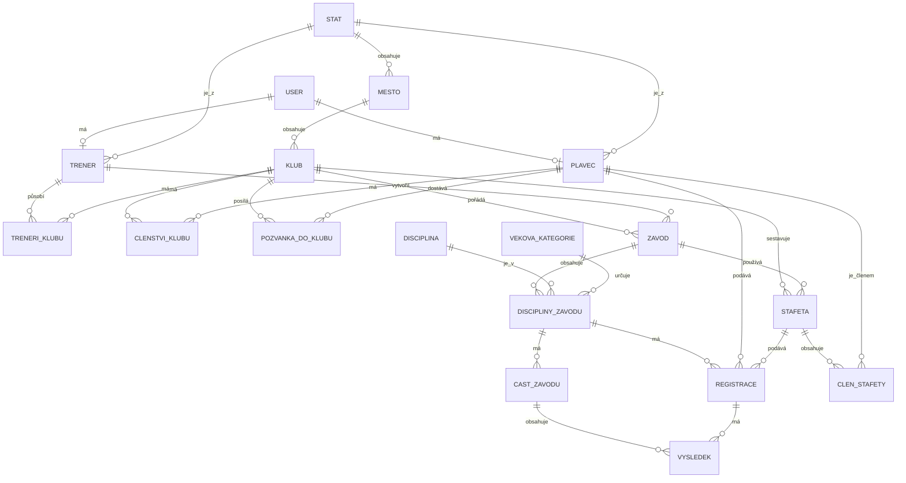

# 🏊‍♂️ SwimPace

Klubová aplikace pro plavce (závodníky) a trenéry, která zjednodušuje organizaci tréninků a závodů. Každý plavecký klub má v aplikaci vlastní oddělený prostor – své trenéry, plavce, závody, přihlášky a výsledky.

> ⚠️ **Aktuálně se jedná o prototyp.** Část funkcí popsaných níže je hotová, část je teprve v plánu (viz [Stav projektu](#-stav-projektu) a [Roadmapa](#-roadmapa)).

Inspirace: [Swimpion](https://www.swimpion.cz), Swim.com

---

## 📌 O projektu

Cílem je vytvořit přehledný systém, kde:

- trenéři plánují závody (a později tréninky) pro svůj klub,
- trenéři přihlašují své svěřence na závody a po skončení zadávají skutečné výsledky,
- plavci vidí své závody, časy, umístění, body a osobní rekordy,
- každý uživatel má svou roli a odpovídající oprávnění,
- součástí bude docházka a statistiky plavců (výsledky, body FINA).

Aplikace **negeneruje náhodné výsledky** – trenér po skončení závodu zadává skutečné časy, umístění a body.

Hlavní tok aplikace:

```text
Klub vznikne nebo se vybere
  -> trenér vytvoří závod
  -> trenér přidá disciplíny
  -> trenér přihlásí své plavce
  -> závod proběhne
  -> po skončení trenér zadá výsledky
  -> plavci si výsledky zobrazí
```

---

## 🤖 Technologie

- Python / Django
- MariaDB (cílová databáze)
- Docker *(plánováno)*

---

## 👥 Uživatelské role

### 🛠️ Administrátor
- spravuje celou aplikaci (kluby, uživatele, závody, disciplíny),
- řeší problematické nebo duplicitní záznamy,
- má přístup ke všem klubům.

### 🧑‍🏫 Trenér
- může působit ve více klubech (lze rozlišit běžného trenéra a správce klubu),
- spravuje své svěřence a zve plavce do klubu,
- vytváří závody pro svůj klub a přidává k nim disciplíny,
- přihlašuje plavce na disciplíny,
- po skončení závodu zadává a upravuje výsledky,
- sleduje statistiky a přehled klubu.

### 🏊‍♂️ Plavec
- při registraci nemusí patřit do žádného klubu,
- vidí svůj osobní profil a může přijmout pozvánku do klubu,
- po aktivaci členství vidí klubový dashboard daného klubu,
- vidí své závody, časy, umístění, body a osobní rekordy,
- **nemůže** měnit oficiální výsledky.

Jeden uživatel může mít současně profil plavce i trenéra. Role proto nejsou
uložené jako jediná hodnota v uživatelském profilu, ale vyplývají z existence
profilu `Plavec` a/nebo `Trener`. Oprávnění trenéra jsou dále určena jeho
aktivním působením v konkrétním klubu.

### 📋 Přehled oprávnění

| Akce | Administrátor | Trenér (svůj klub) | Plavec s členstvím | Plavec bez klubu |
|---|:---:|:---:|:---:|:---:|
| Správa klubů a uživatelů | ✅ | ❌ | ❌ | ❌ |
| Vytvoření závodu | ✅ | ✅ | ❌ | ❌ |
| Přihlášení plavců na závod | ✅ | ✅ | ❌ | ❌ |
| Zadání / úprava výsledků | ✅ | ✅ (po skončení závodu) | ❌ | ❌ |
| Pozvání plavce do klubu | ✅ | ✅ | ❌ | ❌ |
| Přijetí pozvánky | – | – | ✅ | ✅ |
| Klubový dashboard | ✅ | ✅ | ✅ | ❌ |
| Vlastní profil, výsledky, rekordy | ✅ | ✅ | ✅ | ✅ (jen profil) |
| Veřejné závody a výsledky | ✅ | ✅ | ✅ | ✅ |

---

## 🏢 Oddělení klubů

Každý klub má vlastní dashboard a vlastní data. **Trenér klubu A nesmí vidět ani upravovat interní data klubu B.**

Klubová data: trenéři, plavci, závody, disciplíny závodů, registrace, výsledky, statistiky.

Přístup se **nikdy neurčuje podle jména trenéra ani názvu klubu**, ale podle skutečných databázových vazeb a filtrování podle `klub_id`.

```text
User
  -> Plavec
  -> Trener

Trener
  -> TreneriKlubu
       -> Klub

Plavec
  -> ClenstviKlubu
       -> Klub

Klub
  -> Zavod
  -> Trenink

Zavod
  -> DisciplinyZavodu
       -> CastZavodu
  -> Registrace
       -> Vysledek
```

Aplikace je rozdělena na tři části:

- **Veřejná část** – seznam závodů, zveřejněné výsledky, kluby, základní profily.
- **Klubová část** – dashboard klubu, trenéři, plavci, přihlášky, výsledky.
- **Administrace** – správa klubů, závodů, disciplín a účtů.

---

## 🔐 Registrace a členství v klubu

### Trenér
Při registraci trenér:

- vybere existující klub, **nebo**
- zvolí „Můj klub není v seznamu“ a vytvoří nový (název, město, stát, případně datum založení).

Název klubu (resp. kombinace názvu a města) se kontroluje proti duplicitám.
Po vytvoření klubu vznikne trenérovi záznam `TreneriKlubu` s rolí správce
klubu. Trenér tak může později působit i v dalších klubech.

### Plavec
Plavec při registraci klub **nevybírá**. Začíná jako plavec bez klubu – vidí pouze svůj profil a čeká na pozvánku od trenéra.

### Přidání plavce do klubu
Nejbezpečnější je pozvánka nebo pozvánkový kód (přidávání podle jména je rizikové kvůli shodným jménům):

```text
Plavec se zaregistruje
  -> nemá klub
  -> trenér vytvoří pozvánku nebo kód
  -> plavec pozvánku přijme
  -> členství se aktivuje
  -> plavec získá přístup ke klubovému dashboardu
```

Členství je samostatný model, aby se zachovala historie přestupů mezi kluby.
Jeden plavec může mít v jednom klubu více historických členství, ale aktivní
časové intervaly členství se nesmí překrývat. Přijetí pozvánky a vytvoření
nebo aktivace členství probíhá v jedné transakci.

Stavy členství: `čeká na potvrzení` · `aktivní` · `odmítnuté` · `ukončené`

---

## 🏆 Závody

Trenér při vytváření závodu vyplní:

- název, datum, čas začátku, čas konce (nebo předpokládanou délku),
- místo a typ bazénu (25 m / 50 m),
- popis nebo poznámku,
- disciplíny závodu.

Závod patří klubu a eviduje trenéra, který ho vytvořil.

### Stav závodu
Stav se určuje **automaticky podle data a času**, neukládá se ručně:

| Stav | Význam | Co lze dělat |
|---|---|---|
| **Nadcházející** | závod ještě nezačal | detail, přihlášení plavců |
| **Probíhající** | závod začal, ještě neskončil | detail, výsledky zatím nelze zadávat |
| **Ukončený** | závod skončil | zadání / úprava a zobrazení výsledků |

> Výsledky lze zapisovat až po skončení závodu. Pro zadání starších závodů bude možnost „závod již proběhl“, ale ta nesmí umožnit zápis výsledků u budoucího závodu.

---

## 🏊 Disciplíny

Databáze obsahuje **katalog všech závodních disciplín**. Trenér je při vytváření závodu nevytváří znovu, pouze vybere, které se v daném závodě plavou.

- **Individuální:** 50 / 100 / 200 / 400 / 800 / 1500 m volný způsob, 50 / 100 / 200 m znak, prsa a motýlek, 200 / 400 m polohový závod
- **Štafety:** 4 × 50 m a 4 × 100 m volný způsob, polohové štafety, mužské / ženské / smíšené

Model `Disciplina`: kód, název, délka, styl (stabilní interní hodnota,
např. `volny_zpusob`; český název jen pro zobrazení), typ (individuální /
štafeta), aktivní.

Pohlaví není vlastností osoby a soutěžní kategorie zároveň. U plavce a
trenéra se eviduje osobní údaj `pohlavi_osoby`; u konkrétní disciplíny závodu
se případně eviduje `kategorie_pohlavi` (`muz`, `zena`, `smiseny`,
`otevrena`). Věk se řeší samostatnou entitou `VekovaKategorie`, která se
přiřazuje k disciplíně konkrétního závodu.

Konkrétní závod má vlastní výběr disciplín přes vazbu:

```text
Zavod -> DisciplinyZavodu -> Disciplina
```

`DisciplinyZavodu` obsahuje pořadí, číslo disciplíny, plánovaný začátek,
pohlavní kategorii a případně věkovou kategorii.

Každá disciplína závodu může mít jednu nebo více částí přes `CastZavodu`:
rozplavbu, semifinále nebo finále. Tím lze zaznamenat výsledek plavce nebo
štafety v jednotlivých částech závodu.

Ve formuláři závodu bude: výběr jednotlivých disciplín, **Vybrat vše**, **Zrušit vše**, **Vybrat individuální**, **Vybrat štafety**.

---

## 📝 Registrace a výsledky

Registrace na závod **není** výsledek – jsou to dvě oddělené věci.

**Registrace:** disciplína závodu, buď plavec, nebo štafeta, stav
(`přihlášen` / `odhlášen` / `nenastoupil`), trenér, který ji vytvořil, datum
vytvoření a úpravy. Registrace musí obsahovat právě jednoho účastníka:
`plavec_id` nebo `stafeta_id`. Stejný účastník může být do stejné disciplíny
přihlášen pouze jednou.

**Štafeta:** patří ke klubu a závodu a obsahuje uspořádaný seznam plavců
v entitě `ClenStafety`. Počet členů a jejich způsobilost se kontrolují podle
typu štafety.

**Výsledek:** registrace, část závodu, dráha, stav (`platný` / `nedokončil` /
`diskvalifikován` / `bez výsledku`), čas, umístění, body, poznámka, trenér,
který výsledek zadal, a datum poslední úpravy. Jedna registrace může mít
samostatný výsledek v rozplavbě, semifinále i finále.

**Čas** se ukládá jako počet setin sekundy (`1:04.37` → `6437`) a při zobrazení se formátuje zpět. **Umístění** může aplikace dopočítat podle časů v disciplíně; trenér ho může ručně opravit (shodný čas, diskvalifikace, oficiální výsledky).

---

## 🧩 Datový model



> Diagram odpovídá cílovému datovému modelu. Některé vazby zatím nejsou
> implementované v kódu – viz Roadmapa.

---

## 📊 Dashboardy

### Trenér
Vidí pouze svůj klub: přehled klubu, seznam trenérů a plavců, pozvánky a členství, závody rozdělené na nadcházející / probíhající / ukončené, vytvoření závodu, přihlášení plavců, **hromadné zadávání výsledků v tabulce** a klubové statistiky.

### Plavec
Vidí své osobní údaje, stav členství, nadcházející a dokončené závody, výsledky, historii časů podle disciplín (po rozkliknutí závodu), **osobní rekordy** (filtrovatelné podle stylu, vzor Swimpion), umístění a body. Docházka na tréninky přijde v budoucím rozšíření.

Plavec bez klubu vidí jen svůj profil a případné pozvánky.

---

## 🏋️‍♂️ Tréninky *(plánovaná funkce)*

Trenér vytvoří trénink s místem (bazén), popisem, plánem (série, vzdálenosti) a datem a časem. Plavci se na něj přihlásí a vzniká docházka.

---

## 🔒 Bezpečnostní a validační pravidla

- Uživatel nesmí získat přístup k datům klubu změnou ID v URL.
- Každý klubový dotaz je filtrován přes klub přihlášeného uživatele.
- Trenér spravuje pouze kluby, ve kterých má aktivní působení a potřebnou roli.
- Plavce nebo štafetu může přihlásit jen za klub, ke kterému má oprávnění a
  pro který má účastník aktivní členství.
- Plavec může upravovat pouze vlastní neoficiální údaje.
- Výsledky zadává pouze oprávněný trenér po skončení závodu.
- Registrace obsahuje právě jednoho účastníka: plavce nebo štafetu.
- Disciplína musí patřit ke konkrétnímu závodu; registrace je unikátní.
- Čas nesmí být záporný, umístění musí být kladné (pokud je vyplněné), body mají validovaný rozsah.
- Konec závodu, členství a působení trenéra musí být po začátku příslušného
  intervalu.
- Aktivní členství stejného plavce ve stejném klubu se nesmí překrývat.
- Přijatá pozvánka musí vést k vytvoření nebo aktivaci členství.
- Klub a závod nesmí vznikat s prázdnými povinnými údaji.
- Oprávnění mezi kluby budou pokryta testy (povolený i zakázaný přístup).

---

## ✅ Stav projektu

**Cílový datový model:**

- uživatel může mít profil plavce, trenéra nebo oba profily,
- trenér může působit ve více klubech prostřednictvím `TreneriKlubu`,
- plavec se ke klubu váže přes historické `ClenstviKlubu`,
- pozvánky a členství mají oddělený životní cyklus,
- registrace podporuje jednotlivce i štafetu,
- výsledky jsou navázané na konkrétní část závodu,
- model podporuje rozplavby, semifinále, finále a věkové kategorie,
- čas výkonu se ukládá v setinách sekundy.

**Další hlavní etapa:** převést tento model do Django modelů a následně do
uživatelského rozhraní – klubový dashboard, vytváření závodů, katalog
disciplín, pozvánky plavcům, registrace štafet a trenérské zadávání výsledků.

---

## 🗺️ Roadmapa

- [ ] 1. Přepsání cílového datového modelu do Django modelů
- [ ] 2. Migrace na MariaDB a doplnění databázových omezení
- [ ] 3. Model členství, působení trenérů a pozvánek do klubu
- [ ] 4. Kontrola oprávnění trenéra podle konkrétního klubu
- [ ] 5. Úprava registrace pro jednotlivce i štafety
- [ ] 6. Model částí závodu, rozplaveb, semifinále a finále
- [ ] 7. Věkové a pohlavní kategorie disciplín
- [ ] 8. Trenérský dashboard filtrovaný podle klubu
- [ ] 9. Formulář pro vytvoření závodu a výběr disciplín
- [ ] 10. Přihlašování plavců a sestavování štafet
- [ ] 11. Zablokování zadávání výsledků před koncem závodu
- [ ] 12. Hromadný formulář pro výsledky
- [ ] 13. Automatický výpočet / kontrola umístění
- [ ] 14. Dashboard plavce, osobní rekordy a statistiky
- [ ] 15. Testy oprávnění a integrity mezi kluby
- [ ] 16. Opravy validací vstupů a UI
- [ ] 17. OAuth přihlášení
- [ ] 18. Docker a produkční nasazení

### 🚀 Budoucí rozšíření

- tréninky a docházka
- notifikace
- chat mezi trenérem a plavcem

---

## 📂 Struktura projektu

```text
SwimPace/
├── add_disciplines.py
├── check_registrations.py
├── create_future_zavod.py
├── create_trener.py
├── db.sqlite3
├── manage.py
├── plavecke_zavody/
│   ├── __init__.py
│   ├── asgi.py
│   ├── settings.py
│   ├── urls.py
│   └── wsgi.py
├── register_petr.py
├── requirements.txt
└── zavody/
    ├── __init__.py
    ├── admin.py
    ├── apps.py
    ├── models.py
    ├── tests.py
    ├── views.py
    ├── migrations/
    │   ├── 0001_initial.py
    │   ├── 0002_userprofile.py
    │   ├── 0003_vysledek_cas.py
    │   └── __init__.py
    └── templates/
        ├── base.html
        └── zavody/
            ├── add_plavec_to_klub.html
            ├── add_sverenek.html
            ├── home.html
            ├── klub_detail.html
            ├── kluby_list.html
            ├── login.html
            ├── plavci_list.html
            ├── plavec_detail.html
            ├── profile.html
            ├── register.html
            ├── stat_detail.html
            ├── stat_list.html
            ├── trener_detail.html
            ├── treneri_list.html
            ├── zapsat_plavce_na_zavod.html
            ├── zavod_detail.html
            └── zavody_list.html
```

---

## 💻 Spuštění projektu

```bash
git clone https://github.com/TVUJ-UCET/TVUJ-REPOZITAR.git
cd SwimPace

python3 -m venv .venv
source .venv/bin/activate        # Windows: .venv\Scripts\activate
python -m pip install -r requirements.txt

python manage.py migrate
python manage.py runserver
```

Virtuální prostředí `.venv` se na GitHub nahrávat nemá – na každém počítači se vytvoří znovu.

Uložení změn:

```bash
git add .
git commit -m "Popis změn"
git push
```

---

## 🎓 Závěrečný školní projekt

Tato aplikace je vytvářena jako závěrečný školní projekt.
